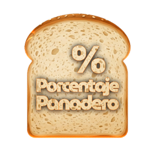
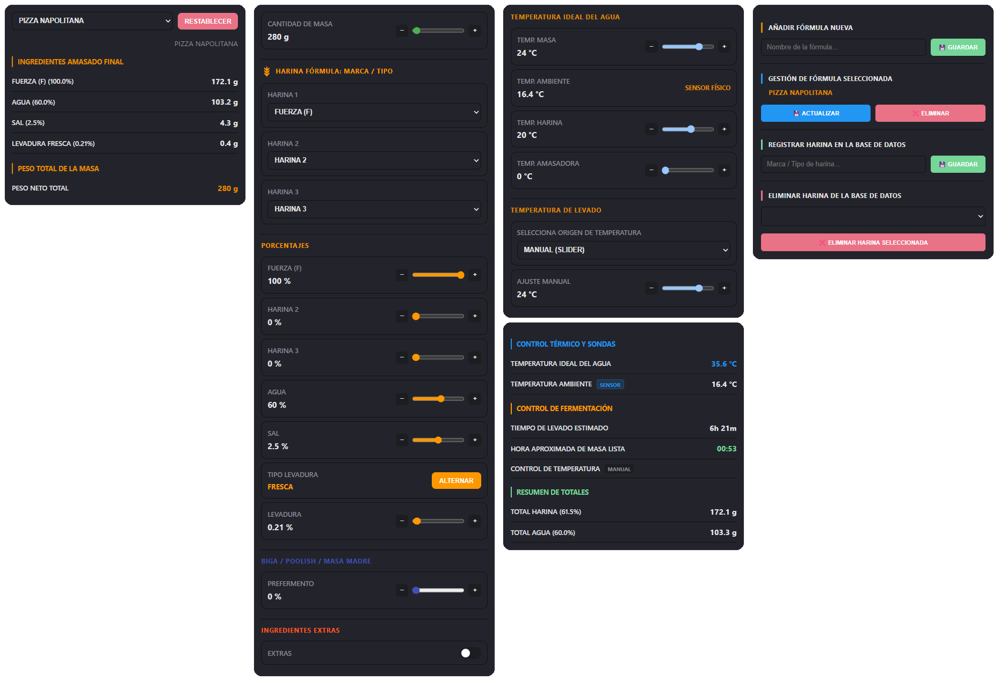

<p align="left"> 
  
</p>
 
## Porcentaje Panadero / Baker's Percentage (Home Assistant)

Herramienta avanzada para calcular masas de pan basada en el porcentaje panadero, diseñada para integrarse de forma nativa en tu panel de Home Assistant.

---

## 🌐 English Abstract (HACS Compliance)
**Baker's Percentage** is an advanced custom integration for Home Assistant that turns your smart home into a professional bakery station. It dynamically scales flours, liquids, preferments, and extra ingredients based on bakers' percentages, targeting precise final dough weights. It features automated **Tang-Zhong** scaling with mixed-scald milk back-up, hidden liquid compensation (eggs/milk), Arrhenius proofing speed estimations, and secure native recipe persistence via Home Assistant Store.

---

## ✨ Características / Features

### 🇪🇸 Castellano
* **Gestión Total:** Añade, crea, guarda y modifica tus fórmulas fácilmente desde la interfaz.
* **Motor Matemático Reactivo:** Introduce la cantidad de masa final (hasta 10 kg) y observa cómo se recalculan al milisegundo los gramos netos de harinas, agua, sal, levaduras e ingredientes enriquecidos.
* **Escaldado Oriental Tang-Zhong / Yudane:** Automatización del engrudo en relación 1:5 descontando la harina y el líquido de la báscula principal con selector dinámico de agua o leche.
* **Escudo Inteligente de Escaldado Mixto:** Si seleccionas base leche para el Tang-Zhong pero la receta se queda sin existencias lácteas, el asistente calcula e inyecta de forma automática agua del grifo a mayores para completar el cazo sin descuadrar la masa final.
* **Compensador de Hidratación Real:** Descuenta y equilibra de forma automática el porcentaje de agua oculta que introducen los huevos batidos y la leche líquida en el bol de amasar.
* **Desglose de Prefermentos Avanzado:** Modelos de cálculo nativos para Poolish, Biga y Masa Madre (refrescos, inóculos e hidrataciones) con asignación y descuento dinámico de harinas netas.
* **Ratio Harina sobre Masa:** Nuevo sensor avanzado que calcula y expone el porcentaje real de la harina total respecto al peso neto de la masa en el bol.
* **Algoritmo Térmico del Agua:** Calcula la temperatura ideal del agua de amasado cruzando variables manuales de fricción o enlazándose en tiempo real a tu termómetro Zigbee físico de la cocina.
* **Algoritmo Térmico de Doble Vía:** Calcula la temperatura ideal del agua de amasado monitorizando de forma constante tu cocina (vía termómetro físico Zigbee), mientras que el tiempo de fermentación se calcula de forma independiente según el entorno elegido (encimera real o slider manual para consigna de cámara).
* **Cinética Biológica Exponencial:** Integra un motor de estimación de levado basado en las curvas termodinámicas reales de Arrhenius (Van 't Hoff). Ofrece predicciones exactas tanto a temperatura ambiente estándar de obrador (24°C) como en aletargamiento de frío extremo en nevera (5°C) para fermentaciones prolongadas.
* **Recetas** Asegura la persistencia de recetas nativas a través de Home Assistant Store.
  
---

### 🇬🇧 English
* **Total Management:** Easily add, create, save, and modify your formulas from the interface.
* **Reactive Math Engine:** Enter the final dough mass (up to 10 kg). Watch net grams of flour, water, salt, yeast, and enriched ingredients recalculate instantly.
* **Tang-Zhong / Yudane Scalding:** Automated roux calculation at a 1:5 ratio. Automatically deducts flour and liquid from the main scale with a dynamic water/milk selector.
* **Smart Mixed-Scalding Shield:** If you choose a milk base for Tang-Zhong but the recipe runs out of dairy, the assistant automatically calculates and adds tap water to complete the mix without altering the final dough weight.
* **True Hydration Compensator:** Automatically discounts and balances hidden water content from beaten eggs and liquid milk in the mixing bowl.
* **Advanced Preferment Breakdown:** Native calculation models for Poolish, Biga, and Sourdough (refreshments, inoculums, and hydration) with dynamic net flour deduction.
* **Flour-to-Dough Ratio:** New advanced sensor that calculates and displays the exact percentage of total flour relative to the net dough weight.
* **Water Thermal Algorithm:** Calculates the ideal water temperature by crossing manual friction variables or syncing in real time with your physical Zigbee kitchen thermometer.
* **Dual-Way Thermal Algorithm:** Calculates the ideal kneading water temperature by constantly tracking your physical Zigbee kitchen thermometer, while independently estimating proofing time based on your chosen environment (live counter-top or manual chamber consign slider).
* **Exponential Biological Kinetics:** Integrates a proofing speed engine based on true Arrhenius (Van 't Hoff) thermodynamic curves. It yields highly accurate time predictions for both standard room fermentation (24°C) and extreme cold retardation in fridges (5°C) for extended dough maturations.
* **Recipes** Secure native recipes persistence via Home Assistant Store.

---

## 📸 Capturas de Pantalla / Screenshots

<p align="center">
  
</p>

## 🇪🇸 Castellano

## ⚙️ Parámetros de Configuración

Define en gramos la cantidad de **masa final** que deseas y, en **porcentaje**, el resto de los valores del cálculo.

* **Inóculo de Masa Madre:** Cantidad exacta de masa madre activa necesaria para iniciar el prefermento según el porcentaje seleccionado.
* **Hidratación de Masa Madre:** Porcentaje de agua respecto a la harina en tu masa madre de reserva.
* **Porcentaje de Masa Madre:** Un porcentaje del 33.3% equivale a una proporción 1:1:1 (masa madre | harina | agua) del refresco tradicional.
* **Harina del Prefermento:** Indica de cuál de las harinas de la receta se restará la cantidad destinada al prefermento (por defecto, se descuenta de la Harina 1).
* **Control Térmico:** Control de la temperatura final de la masa cruzando ambiente, harina, prefermento y fricción de la amasadora.

---

## 📥 Instalación

### Método:

1. Ve a **Configuración** ➔ **Marketpalace**.
2. En la esquina superior derecha selecciona **Añadir desde enlace**.
3. Pega la URL de este repositorio: `https://github.com/DelBierzo/porcentaje_panadero` (Si te pregunta, selecciona **Integración** y haz clic en **Añadir**.
4. Ahora busca el repositorio **Porcentaje Panadero**, e instala.

5. Si no se añade automáticamente, asegúrate de añadir el recurso correspondiente:

	Configuración > Paneles > Recursos

	AÑADIR RECURSO
	* **URL:** `/porcentaje_panadero_ui/porcentaje-panadero-card.js?v=5.0.2`
	* **Tipo de recurso:** Módulo JavaScript (`JavaScript Module`)

Con esto incorporamos las tarjetas:

```
type: custom:porcentaje-panadero-calculadora-card
type: custom:porcentaje-panadero-formula-card
type: custom:porcentaje-panadero-control-termico-card
type: custom:porcentaje-panadero-info-card
type: custom:porcentaje-panadero-control-panel-card
```

## 📝 Notas Importantes sobre el Sensor Físico de Temperatura

Si durante la instalación inicial del asistente configuras un **sensor de temperatura físico** (Zigbee, Wi-Fi, etc.) en lugar del slider manual, ten en cuenta el siguiente:

* **Para la temperatura ideal del agua, siempre se tiene en cuenta la temperatura del sensor fisico (temperatura ambiente "real"), en cambio tienes la opccion de alternar entre sensor fisico / manual, para la temperatura de levado, pudiendo elegir otro lugar donde llevar a cabo la fermentacion de la masa.** 


## 🎛️ Tarjetas Lovelace (Modos de Uso)

La integración genera de forma automática **78 entidades nativas** que puedes explotar en tu interfaz a través de dos modalidades:

### 🔹 Modo Básico : [`tarjeta básica`](https://github.com/DelBierzo/porcentaje_panadero/blob/main/castellano/Tarjeta_Lovelace_Basica.yaml)

Exprime al máximo la interfaz visual, requiere la descarga previa del complemento "expander-card" desde **Marketpalace**:

* 📦 [expander-card](https://github.com/MelleD/lovelace-expander-card) — Menús desplegables de la interfaz.

### 🔸 Modo Avanzado: [`tarjeta avanzada`](https://github.com/DelBierzo/porcentaje_panadero/blob/main/castellano/Tarjeta_Lovelace_Avanzada.yaml)

---

## 🇬🇧 English

## ⚙️ Configuration Parameters

Define the **final dough weight** in grams and the rest of the calculation values in **percentages**.

* **Sourdough Inoculum:** The exact amount of active sourdough starter required to build the preferment based on the selected percentage.
* **Sourdough Hydration:** The percentage of water relative to flour in your mother sourdough culture.
* **Sourdough Percentage:** A percentage of 33.3% equals a traditional 1:1:1 feeding ratio (sourdough culture | flour | water).
* **Preferment Flour:** Specifies from which recipe flour the preferment portion will be subtracted (by default, it is deducted from Flour 1).
* **Thermal Control:** Manages the final dough temperature by crossing variables for ambient, flour, preferment, and mixer friction temperatures.

---

## 📥 Installation

### Method:

1. Go to **Settings** ➔ **Marketplace**.
2. In the top right corner, select **Add from link**.
3. Paste the URL of this repository: `https://github.com/DelBierzo/porcentaje_panadero` (If prompted, select **Integration** and click **Add**).
4. Now search for the **Porcentaje Panadero** repository, and install it.

5. If it is not added automatically, make sure to add the corresponding resource:

	Settings > Dashboards > Resources

	ADD RESOURCE
	* **URL:** `/porcentaje_panadero_ui/porcentaje-panadero-card.js?v=5.0.2`
	* **Resource type:** JavaScript Module (`JavaScript Module`)

With this, we add the cards:

```
type: custom:porcentaje-panadero-calculadora-card
type: custom:porcentaje-panadero-formula-card
type: custom:porcentaje-panadero-control-termico-card
type: custom:porcentaje-panadero-info-card
type: custom:porcentaje-panadero-control-panel-card
```
---

## 📝 Important Notes on the Physical Temperature Sensor

If during the initial setup wizard you configure a **physical temperature sensor** (Zigbee, Wi-Fi, etc.) instead of the manual slider, please note the following:

* **For the ideal water temperature, the physical sensor's temperature ("real" ambient temperature) is always taken into account. On the other hand, you have the option to toggle between the physical sensor and the manual slider for the proofing temperature, allowing you to choose a different location to ferment your dough.** 


## 🎛️ Lovelace Cards (Usage Modes)

The integration automatically generates **78 native entities** that you can utilize in your interface through two modes:

### 🔹 Basic Mode : [`basic card`](https://github.com/DelBierzo/porcentaje_panadero/blob/main/castellano/Tarjeta_Lovelace_Basica.yaml)

Get the most out of the UI by installing 'expander-card' from **Marketpalace** first.

* 📦 [expander-card](https://github.com/MelleD/lovelace-expander-card) — Manage drop-down menus in the interface.
  
### 🔸 Advanced Mode: [`advanced card`](https://github.com/DelBierzo/porcentaje_panadero/blob/main/castellano/Tarjeta_Lovelace_Avanzada.yaml)

---

## 🛠️ Desarrollo Local y Contribuciones / Contributions

Si deseas modificar las ecuaciones panaderas internas o proponer mejoras en la interfaz Lovelace, eres más que bienvenido a abrir un *Pull Request* o reportar un *Issue*.

### Licencia / License
Este proyecto es software libre y está licenciado bajo los términos de la [Licencia MIT](LICENSE).

---

Developed with 🥖 & ☕ by **[@DelBierzo](https://github.com/DelBierzo)**.
